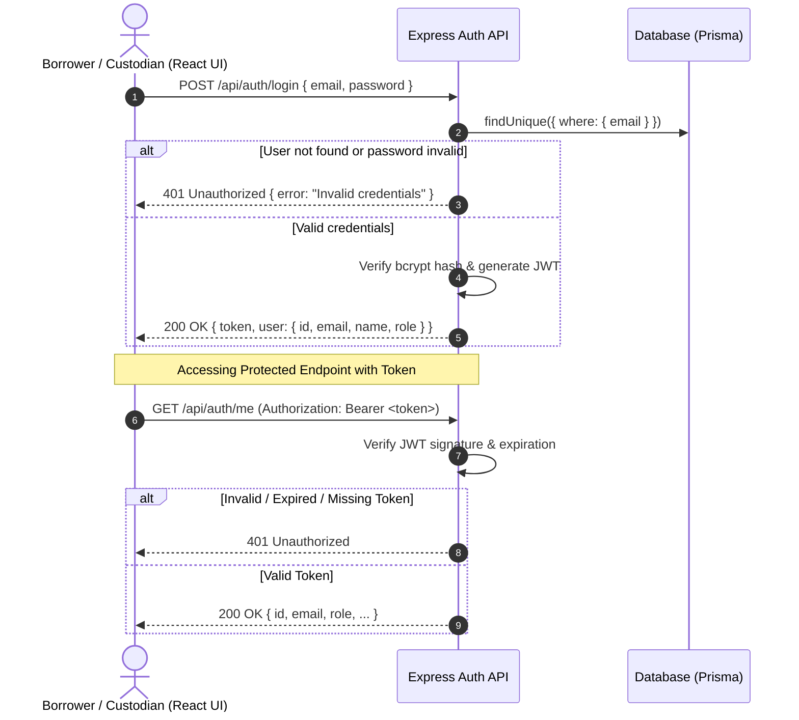

# Feature Engineering Contract: F-01 Authentication & RBAC

- **Feature ID:** F-01
- **Related Requirements:** FR-01, FR-02, BR-03, NFR-01, NFR-02
- **Target Sprint:** Sprint 1
- **Status:** APPROVED / IN-IMPLEMENTATION
- **Author:** Student A (LiNkPaWaRuT)
- **Reviewer:** Student B

---

## 1. Feature SDS: Behavior, Workflow & Permissions
Provides secure user authentication using email and hashed passwords. Upon successful authentication, a JSON Web Token (JWT) is issued containing the user ID and role (`BORROWER` or `CUSTODIAN`). 

Protected routes verify the token via middleware. Restricted custodian endpoints inspect the decoded token and reject non-custodian actors with HTTP 403 Forbidden.



---

## 2. API Specifications

### `POST /api/auth/login`
- **Request Body:**
  ```json
  {
    "email": "borrower1@example.com",
    "password": "Password123!"
  }
  ```
- **Success Response (200 OK):**
  ```json
  {
    "success": true,
    "token": "eyJhbGciOi...",
    "user": {
      "id": "cm...01",
      "email": "borrower1@example.com",
      "name": "Alice Borrower",
      "role": "BORROWER"
    }
  }
  ```
- **Failure Response (401 Unauthorized):**
  ```json
  {
    "success": false,
    "error": {
      "code": "AUTH_INVALID_CREDENTIALS",
      "message": "Invalid email or password."
    }
  }
  ```

### `POST /api/auth/logout`
- **Headers:** `Authorization: Bearer <token>`
- **Success Response (200 OK):**
  ```json
  {
    "success": true,
    "message": "Logged out successfully."
  }
  ```

### `GET /api/auth/me`
- **Headers:** `Authorization: Bearer <token>`
- **Success Response (200 OK):** Current authenticated user object.
- **Failure Response (401 Unauthorized):** `{ "success": false, "error": { "code": "AUTH_UNAUTHORIZED", "message": "Authentication required." } }`

---

## 3. Acceptance Criteria (AC)
- **AC-01:** Submitting valid email & password to `POST /api/auth/login` returns HTTP 200 with signed JWT and user identity profile.
- **AC-02:** Submitting invalid credentials returns HTTP 401 Unauthorized with generic message.
- **AC-03:** Calling `POST /api/auth/logout` returns HTTP 200 and client clears token.
- **AC-04:** Calling protected endpoints without token returns HTTP 401 Unauthorized.
- **AC-05:** Borrower token calling custodian-only endpoints returns HTTP 403 Forbidden.
- **AC-06:** Passwords must be hashed using `bcrypt` before storage (no plaintext in database).

---

## 4. Software Test Specification (STS)

| Test ID | Linked AC | Test Level | Preconditions / Input | Expected Result |
| :--- | :--- | :--- | :--- | :--- |
| `TEST-AUTH-01` | `AC-01` | Integration | Seeded user `borrower1@example.com`, `Password123!` | 200 OK, token returned, user role `BORROWER` |
| `TEST-AUTH-02` | `AC-02` | Integration | Valid email, wrong password `WrongPassword!` | 401 Unauthorized, no token issued |
| `TEST-AUTH-03` | `AC-04` | Integration | Request `GET /api/auth/me` without Authorization header | 401 Unauthorized |
| `TEST-AUTH-04` | `AC-05` | Integration | Request Custodian route with Borrower JWT | 403 Forbidden |
| `TEST-AUTH-05` | `AC-06` | Unit | Inspect database record for seeded user | `passwordHash` starts with `$2b$` and != plaintext |

---

## 5. Definition of Done (DoD)
- Contract committed to `docs/sprints/sprint-1/F01-AUTH.md`.
- Automated tests in `tests/auth.test.ts` passing.
- React Login screen functional with input validation and role-based redirect.
- PR opened into `staging` and approved by Student B.
