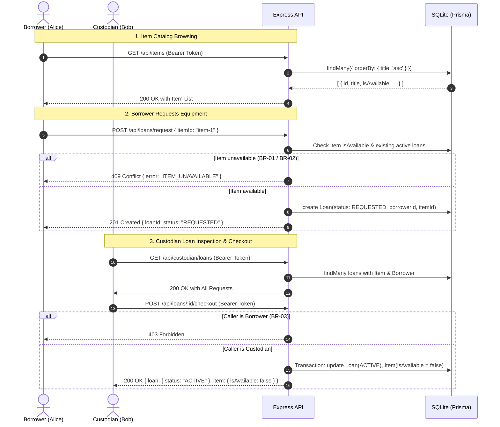

# Feature Engineering Contract: F-02 Item Catalog, Request, and Custodian Checkout Workflow

- **Feature ID:** F-02
- **Related Requirements:** FR-03 (View Catalog), FR-04 (Request Item), FR-05 (Checkout Approval), FR-06 (Personal Loans), FR-07 (Custodian Loans View), BR-01 (Single Item Exclusivity), BR-02 (No Duplicate Active Loans), BR-03 (Role Segregation), BR-04 (Ownership Isolation)
- **Target Sprint:** Sprint 1
- **Status:** APPROVED / IN-IMPLEMENTATION
- **Author:** Student B (Kawinpob Amnuaywittayakul)
- **Reviewer:** Student A (LiNkPaWaRuT)

---

## 1. Feature SDS: Behavior, Workflow & Permissions

Feature F-02 establishes the core domain vertical slice of the Inventory & Borrowing System. Department borrowers can browse physical equipment inventory with live availability status, submit loan requests for available items, and view their personal loan history. Custodians have elevated oversight to inspect all loan requests and approve physical checkouts, atomically transitioning the loan into an active state and reserving the equipment item.

### Security & Role Boundaries
- **Borrower (`BORROWER`):** Can query `/api/items`, submit borrow requests via `POST /api/loans/request`, and retrieve personal loan records via `GET /api/loans/my-loans` or `GET /api/loans/:id` (own records only). Any attempt to trigger custodian checkout or inspect another borrower's loan is rejected with `403 Forbidden`.
- **Custodian (`CUSTODIAN`):** Can inspect all department loan requests via `GET /api/custodian/loans` and approve checkouts via `POST /api/loans/:id/checkout`.

### Domain Workflow Diagram


---

## 2. API Specifications

### `GET /api/items`
- **Description:** Retrieve the catalog of lab items with availability status.
- **Headers:** `Authorization: Bearer <token>`
- **Response (200 OK):**
  ```json
  {
    "success": true,
    "items": [
      {
        "id": "item-uuid-1",
        "title": "Digital Oscilloscope DS1054Z",
        "serialNumber": "OSC-2026-001",
        "category": "Electronics Lab",
        "isAvailable": true
      }
    ]
  }
  ```

### `POST /api/loans/request`
- **Description:** Borrower initiates a borrow request for an available item.
- **Headers:** `Authorization: Bearer <token>` (Role: `BORROWER`)
- **Request Body:**
  ```json
  {
    "itemId": "item-uuid-1"
  }
  ```
- **Success Response (201 Created):**
  ```json
  {
    "success": true,
    "loan": {
      "id": "loan-uuid-1",
      "itemId": "item-uuid-1",
      "borrowerId": "user-uuid-1",
      "status": "REQUESTED",
      "requestedAt": "2026-11-05T15:30:00.000Z"
    }
  }
  ```
- **Error Responses:**
  - `400 Bad Request`: `{ "success": false, "error": { "code": "INVALID_INPUT", "message": "itemId is required." } }`
  - `404 Not Found`: `{ "success": false, "error": { "code": "ITEM_NOT_FOUND", "message": "Item does not exist." } }`
  - `409 Conflict (BR-01 / BR-02)`: `{ "success": false, "error": { "code": "ITEM_UNAVAILABLE", "message": "Item is not available for borrowing." } }`

### `GET /api/loans/my-loans`
- **Description:** Borrower retrieves only their own loan requests and history.
- **Headers:** `Authorization: Bearer <token>` (Role: `BORROWER`)
- **Response (200 OK):**
  ```json
  {
    "success": true,
    "loans": [
      {
        "id": "loan-uuid-1",
        "status": "REQUESTED",
        "requestedAt": "2026-11-05T15:30:00.000Z",
        "item": {
          "id": "item-uuid-1",
          "title": "Digital Oscilloscope DS1054Z",
          "serialNumber": "OSC-2026-001"
        }
      }
    ]
  }
  ```

### `GET /api/loans/:id`
- **Description:** Retrieve details of a specific loan.
- **Headers:** `Authorization: Bearer <token>`
- **Response (200 OK):** Loan object with item and borrower details.
- **Error Responses:**
  - `403 Forbidden (BR-04)`: Returned if an authenticated Borrower attempts to inspect another borrower's loan.
  - `404 Not Found`: Loan ID does not exist.

### `GET /api/custodian/loans`
- **Description:** Custodian retrieves all loan requests and active loans across the system.
- **Headers:** `Authorization: Bearer <token>` (Role: `CUSTODIAN`)
- **Response (200 OK):**
  ```json
  {
    "success": true,
    "loans": [
      {
        "id": "loan-uuid-1",
        "status": "REQUESTED",
        "requestedAt": "2026-11-05T15:30:00.000Z",
        "item": { "id": "item-uuid-1", "title": "Digital Oscilloscope DS1054Z" },
        "borrower": { "id": "borrower-1", "name": "Alice Borrower", "email": "borrower1@example.com" }
      }
    ]
  }
  ```
- **Error Responses:**
  - `403 Forbidden`: Returned if a borrower calls this endpoint.

### `POST /api/loans/:id/checkout`
- **Description:** Custodian approves physical checkout, updating loan status to `ACTIVE` and `item.isAvailable` to `false`.
- **Headers:** `Authorization: Bearer <token>` (Role: `CUSTODIAN`)
- **Response (200 OK):**
  ```json
  {
    "success": true,
    "loan": {
      "id": "loan-uuid-1",
      "status": "ACTIVE",
      "checkedOutAt": "2026-11-05T15:45:00.000Z",
      "item": {
        "id": "item-uuid-1",
        "isAvailable": false
      }
    }
  }
  ```
- **Error Responses:**
  - `403 Forbidden (BR-03)`: Non-custodian attempting checkout approval.
  - `404 Not Found`: Loan record not found.
  - `409 Conflict (BR-01)`: Loan is not in REQUESTED status or item is already checked out.

---

## 3. Acceptance Criteria (AC)

- **AC-07:** Borrower can view catalog of items with live `isAvailable` status via `GET /api/items`.
- **AC-08:** Borrower can request an available item via `POST /api/loans/request`, creating a loan with status `REQUESTED` and returning HTTP 201.
- **AC-09 (BR-01):** Requesting or checking out an item with `isAvailable == false` is rejected with HTTP 409 Conflict.
- **AC-10 (BR-02):** Prevent duplicate active loans for the same item (rejected with HTTP 409 Conflict).
- **AC-11 (BR-04):** Borrower A requesting `/api/loans/:id` owned by Borrower B returns HTTP 403 Forbidden.
- **AC-12:** Custodian can view pending requests and execute checkout (`POST /api/loans/:id/checkout`), setting loan status to `ACTIVE` and `item.isAvailable = false`.

---

## 4. Software Test Specification (STS)

| Test ID | Linked AC | Test Level | Preconditions / Input | Expected Result |
| :--- | :--- | :--- | :--- | :--- |
| `TEST-LOAN-01` | `AC-08` | Integration | Seeded Borrower 1 requests available item (`OSC-2026-001`) | HTTP 201 Created, loan persisted with status `REQUESTED` |
| `TEST-LOAN-02` | `AC-09`, `AC-10` | Integration | Seeded Borrower 1 requests unavailable item (`LA-2026-003`) | HTTP 409 Conflict, no duplicate loan created |
| `TEST-LOAN-03` | `AC-12` | Integration | Custodian checks out requested loan via `POST /api/loans/:id/checkout` | HTTP 200 OK, loan status becomes `ACTIVE`, item `isAvailable` becomes `false` |
| `TEST-LOAN-04` | `AC-05`, `BR-03` | Integration | Borrower attempts to call `POST /api/loans/:id/checkout` | HTTP 403 Forbidden, role guard rejects request |
| `TEST-LOAN-05` | `AC-11`, `BR-04` | Integration | Borrower 1 attempts `GET /api/loans/:id` for a loan owned by Borrower 2 | HTTP 403 Forbidden, ownership isolation enforced |

---

## 5. Definition of Done (DoD)

1. Feature contract committed to `docs/sprints/sprint-1/F02-BORROWING.md`.
2. Automated tests passing in `tests/borrowing.test.ts` (with TDD progression documented).
3. React Borrower View: Item catalog grid with real-time badges, borrow request action, and "My Loans" list.
4. React Custodian View: Loan request management table with "Approve Checkout" action and status update.
5. All tests in test suite (`tests/auth.test.ts` and `tests/borrowing.test.ts`) passing with 0 failures.
6. Pull Request created against `staging` for Student A review.
