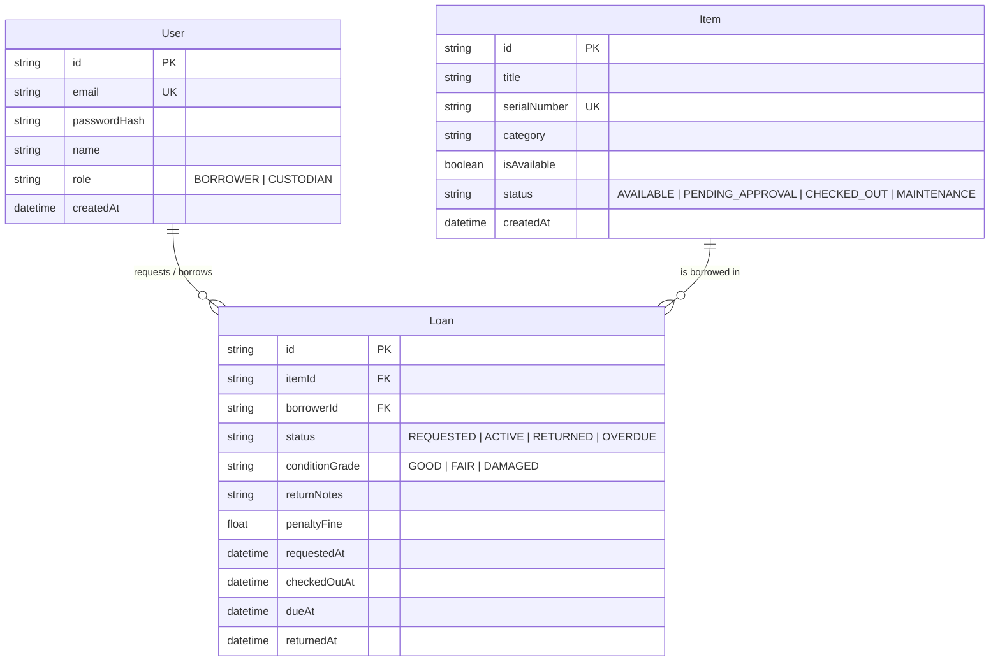

# System-Level Software Design Specification (SDS)

## 1. System Architecture & Stack Overview

The Inventory and Borrowing System follows a 3-tier architecture implemented as a clean modular monolith:
1. **Presentation Layer (UI):** React Single Page Application (built with Vite), providing dedicated views for Borrowers and Custodians, client-side routing, and token handling.
2. **Application / API Layer:** Node.js with Express.js exposing a RESTful JSON API. Business logic, input validation, authentication (JWT), and authorization middleware are strictly enforced here.
3. **Data Layer:** SQLite (for rapid local development, testing, and file portability) managed through **Prisma ORM**. The data schema is container-ready and prepared for seamless cutover to PostgreSQL for GCP deployment in Lab 5.

```mermaid
flowchart TD
    subgraph Client ["Frontend (React + Vite)"]
        UI_Login["Login & Auth View"]
        UI_Borrower["Borrower Catalog & Loans"]
        UI_Custodian["Custodian Management Dashboard"]
    end

    subgraph Server ["Backend (Node.js + Express)"]
        Router["Express Router (/api)"]
        AuthMid["Auth & RBAC Middleware"]
        AuthCtrl["Auth Controller"]
        ItemCtrl["Item Controller"]
        LoanCtrl["Loan Controller (Domain Rules)"]
    end

    subgraph Storage ["Persistence Layer (Prisma ORM)"]
        Prisma["Prisma Client"]
        DB[(SQLite / PostgreSQL Database)]
    end

    Client -->|HTTP / JSON (Bearer Token)| Router
    Router --> AuthMid
    AuthMid --> AuthCtrl
    AuthMid --> ItemCtrl
    AuthMid --> LoanCtrl
    AuthCtrl --> Prisma
    ItemCtrl --> Prisma
    LoanCtrl --> Prisma
    Prisma --> DB
```

---

## 2. Data Model & Entity-Relationship Design



### Constraints & Integrity Rules:
- `User.email`: Unique, non-null.
- `Item.serialNumber`: Unique, non-null.
- `Item.isAvailable`: Defaults to `true`. Set to `false` when an active loan exists.
- `Loan.status`: Enum `REQUESTED`, `ACTIVE`, `RETURNED`.

---

## 3. UI, API & Access Conventions

### 3.1 Authentication & Token Lifecycle
- Tokens are JSON Web Tokens (JWT) signed with a server-side secret (`JWT_SECRET`).
- Payload contains `{ userId: string, role: string, email: string }`.
- Token expiry: 24 hours.
- Clients attach the token via header: `Authorization: Bearer <token>`.
- `POST /api/auth/logout`: Client purges token from storage; server marks token invalid if utilizing a blacklist table.

### 3.2 Role & Permission Matrix

| Protected Operation | Endpoint Path | Method | Borrower Access | Custodian Access | Business Rule Enforced |
| :--- | :--- | :---: | :---: | :---: | :--- |
| **Authenticate** | `/api/auth/login` | POST | Allowed | Allowed | Valid credentials |
| **Current User** | `/api/auth/me` | GET | Allowed | Allowed | Token required |
| **View Catalog** | `/api/items` | GET | Allowed | Allowed | Any authenticated user |
| **Request Loan** | `/api/loans/request` | POST | **Allowed** | Denied | `item.isAvailable == true`, `BR-01`, `BR-02`, `BR-04` (max 2 active loans) |
| **Batch Request (Sprint 3)** | `/api/loans/batch` | POST | **Allowed** | Denied | Atomic transaction, max 2 items, `BR-04`, `BR-09` |
| **View My Loans**| `/api/loans/my-loans`| GET | **Allowed** | Allowed | Borrower sees only own records |
| **View All Loans**| `/api/custodian/loans`| GET | **Forbidden (403)** | **Allowed** | Restricted to Custodian |
| **Record Checkout**| `/api/loans/:id/checkout`| POST | **Forbidden (403)** | **Allowed** | Item must be available; transitions to `ACTIVE`; sets `dueAt` |
| **Check-in Return (Sprint 2)**| `/api/loans/:id/return`| POST | **Forbidden (403)** | **Allowed** | Restores availability (or maintenance if damaged), clears quota |

### 3.3 API Error Response Standard
All API errors return consistent JSON:
```json
{
  "success": false,
  "error": {
    "code": "ITEM_UNAVAILABLE",
    "message": "Item is already checked out or has an active request."
  }
}
```

For loan quota violations (`BR-04`), `POST /api/loans/request` returns `HTTP 409 Conflict`:
```json
{
  "error": "LOAN_LIMIT_EXCEEDED",
  "message": "Borrower has reached the maximum limit of 2 concurrent loans (pending or active)."
}
```

### 3.4 Borrower Dashboard UI Quota Integration
In `BorrowerDashboard.tsx`:
- The client counts active loans where `loan.status === 'REQUESTED' || loan.status === 'ACTIVE'`.
- The UI renders an active quota indicator badge: `Active Loans: {activeLoanCount} / 2`.
- When an attempt to borrow returns `409` with error `LOAN_LIMIT_EXCEEDED`, the UI displays a dismissible warning alert advising the borrower to await Custodian check-in or return existing equipment.

### 3.5 Return & Condition Grading Contract (Sprint 2 / F-03)
Endpoint: `POST /api/loans/:id/return`
Headers: `Authorization: Bearer <custodian_jwt>`
Payload:
```json
{
  "conditionGrade": "GOOD | FAIR | DAMAGED",
  "returnNotes": "Optional inspection notes"
}
```
Responses:
- `200 OK`: Loan status -> `RETURNED`, item availability restored (or `MAINTENANCE` if damaged).
  ```json
  {
    "success": true,
    "message": "Equipment return successfully recorded.",
    "loan": { "id": "...", "status": "RETURNED", "conditionGrade": "GOOD" },
    "item": { "id": "...", "isAvailable": true, "status": "AVAILABLE" }
  }
  ```
- `403 Forbidden`: If called by `BORROWER` role.
- `409 Conflict`: If loan is not currently in `ACTIVE` status.

### 3.6 Multi-Item Batch Request Contract (Sprint 3 / F-05)
Endpoint: `POST /api/loans/batch`
Headers: `Authorization: Bearer <borrower_jwt>`
Payload:
```json
{
  "itemIds": ["item-id-1", "item-id-2"]
}
```
Responses:
- `201 Created`: All items requested successfully inside a single database transaction.
- `409 Conflict`: If total batch size + existing active/requested loans > 2 (`LOAN_LIMIT_EXCEEDED`), or if any item in the batch is unavailable. Entire transaction rolled back.

---

## 4. Configuration & Deployment Design
- All secrets and configuration variables are externalized via `.env`.
- Database URL: `DATABASE_URL="file:./dev.db"` (for SQLite) or `postgresql://...` (for cloud).
- Containerization: Monolith will be containerized with a multi-stage Dockerfile (build client -> run Express serving static build and API) ready for GCP Cloud Run in Lab 5.
